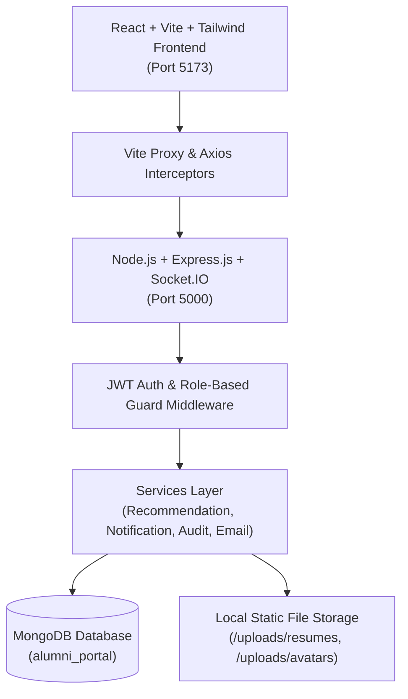

# 🎓 Integrated Alumni–Student Mentorship & Job Portal (`AlumNet`)

> A production-grade Full Stack MERN platform connecting current students with alumni for structured 1-on-1 mentorship, intelligent job matching, live chat communication, career event registrations, and administrative governance.

---

## 📌 Table of Contents
1. [System Architecture & Overview](#-system-architecture--overview)
2. [Tech Stack](#-tech-stack)
3. [Key Features by Role](#-key-features-by-role)
4. [Intelligent Recommendation Engine](#-intelligent-recommendation-engine)
5. [Quick Start & Setup Guide](#-quick-start--setup-guide)
6. [Pre-Seeded Demo Credentials](#-pre-seeded-demo-credentials)
7. [Automated Testing Suite](#-automated-testing-suite)
8. [API Documentation Reference](#-api-documentation-reference)
9. [Security, Performance & Best Practices](#-security-performance--best-practices)

---

## 🏛 System Architecture & Overview



### Architecture Highlights:
- **Clean Layered MVC Architecture**: Clear separation of controllers, services, database models, and route middleware.
- **Bi-directional Real-Time Communication**: Socket.IO for instant private messaging, typing indicators, and live system notifications with graceful REST fallback.
- **Zero Paid Dependencies**: Built-in Multer storage for PDF resume uploads and avatar images; fallback in-memory email logger for session notices and application status updates.

---

## 🛠 Tech Stack

| Layer | Technologies |
| :--- | :--- |
| **Frontend** | React 18, Vite, Tailwind CSS, React Router v6, Axios, Recharts, Lucide React, Context API |
| **Backend** | Node.js, Express.js, Socket.IO, Mongoose ODM, JSON Web Tokens (JWT), Bcrypt.js, Multer |
| **Database** | MongoDB (Local Community Server / MongoDB Atlas) |
| **Dev & Tools** | Concurrently, PostCSS, Autoprefixer, ESLint |

---

## 🌟 Key Features by Role

### 👨‍🎓 Student Role
- **Personalized Dashboard**: View mentorship requests, upcoming sessions, job applications pipeline, and AI-recommended mentors & jobs.
- **Smart Mentor Discovery**: Filter alumni by department, company, skills, or search keywords. View real-time match percentage scores.
- **Mentorship Roadmaps & Sessions**: Send structured mentorship requests, track milestones, and book 1-on-1 virtual sessions.
- **Career & Job Portal**: Search jobs and internships, view skill match scores, 1-click apply with PDF resume upload, and monitor visual application status:
  `APPLIED` ➔ `UNDER_REVIEW` ➔ `SHORTLISTED` ➔ `INTERVIEW` ➔ `SELECTED` / `REJECTED`.
- **Peer & Alumni Messaging**: Real-time direct chat with assigned mentors.
- **Events & Resources**: Register for webinars and workshops with seat count limits; access curated learning guides.

### 👩‍💼 Alumni Role
- **Mentorship Hub**: Accept or decline student mentorship requests; manage active mentees and create milestone action plans.
- **Session Scheduler**: Manage availability, schedule meeting links, and prevent scheduling collisions.
- **Talent Recruitment**: Post jobs and internships, filter applicants, review PDF resumes directly in-browser, and update candidate stages with feedback.
- **Community Engagement**: Host campus events, share study resources, and receive student reviews and 5-star ratings upon mentorship completion.

### 🛡️ Admin Role
- **Platform Telemetry & Analytics**: Visual charts powered by Recharts tracking monthly registrations, application trends, and role distributions.
- **User Governance**: View all registered students and alumni; verify alumni profiles with verified badges; activate/deactivate accounts.
- **Job Moderation**: Review posted job listings, approve or remove non-compliant postings.
- **Audit Logs & Moderation**: Real-time audit trail capturing logins, profile modifications, job submissions, and role alterations.

---

## 🧠 Intelligent Recommendation Engine

The platform features a proprietary multi-factor matching engine implemented in `backend/src/services/recommendationService.js`:

### 1. Job Match Algorithm (0 – 100%)
- **Skill Overlap (50%)**: Direct match between student skills and job requirements.
- **Industry Match (20%)**: Alignment between student target industry and employer sector.
- **Role Match (20%)**: Overlap between student preferred roles and job title.
- **Interest Match (10%)**: Extracurricular or technical interest alignment.

### 2. Mentor Match Algorithm (0 – 100%)
- **Skills/Expertise Overlap (45%)**: Student target skills mapped against alumni core domain expertise.
- **Department Alignment (20%)**: Common academic background/major.
- **Target Industry Match (20%)**: Overlap between student goals and mentor's current industry.
- **Preferred Role Match (15%)**: Alignment with mentor's current job role/title.

---

## 🚀 Quick Start & Setup Guide

### Prerequisites
- **Node.js**: `v18.0.0` or higher (tested on Node v24)
- **MongoDB**: Local MongoDB instance running on `mongodb://127.0.0.1:27017` or a MongoDB Atlas URI.

### 1. Installation
Clone the repository and install dependencies across the root, backend, and frontend with a single command:
```bash
npm run install-all
```

### 2. Environment Configuration
The backend comes pre-configured with standard defaults in `backend/.env`. You can modify it if needed:
```env
PORT=5000
NODE_ENV=development
MONGO_URI=mongodb://127.0.0.1:27017/alumni_portal
JWT_SECRET=your_super_secret_jwt_key_here_change_in_production_32chars
JWT_EXPIRE=7d
CLIENT_URL=http://localhost:5173
```

### 3. Seed Sample Database
Populate the database with realistic demo accounts, active mentorships, 15 job postings, mock applications, events, and reviews:
```bash
npm run seed
```

### 4. Run Development Servers
Launch both the Express backend (`http://localhost:5000`) and the Vite React frontend (`http://localhost:5173`) concurrently:
```bash
npm run dev
```

Visit **`http://localhost:5173`** in your browser.

---

## 🔑 Pre-Seeded Demo Credentials

All seeded demo accounts use the standard password: **`Password123!`**

| Role | Email | Features to Test |
| :--- | :--- | :--- |
| **Admin** | `admin@example.com` | Telemetry graphs, verify alumni, manage users, audit logs, job approvals |
| **Student** | `student@example.com` | Mentor matching, request mentorship, apply to jobs with resume, real-time chat |
| **Alumni** | `alumni@example.com` | Accept mentee requests, schedule sessions, post new jobs, manage applicants |

*Note: The login screen includes quick 1-click login buttons for instant evaluation.*

---

## 🧪 Automated Testing Suite

Run the end-to-end integration and business logic verification suite:
```bash
npm test
```

### Verified Test Cases:
1. `Auth System`: Register, login, password hash verification, JWT payload inspection.
2. `Student Profile`: Retrieval, profile enrichment, skills update.
3. `Alumni Profile`: Verification status update, expertise filtering.
4. `Recommendation Engine`: Accurate weighted skill & role calculation.
5. `Mentorship Flow`: Request submission, state transitions (`PENDING` ➔ `ACCEPTED`).
6. `Session Conflict Prevention`: Double-booking prevention on conflicting timeslots.
7. `Job Portal & Duplicate Prevention`: Job posting and prevention of multiple applications by the same student.
8. `Review Constraints`: Verification that only completed mentorships can submit ratings.
9. `Admin Telemetry`: Retrieval of user stats, active jobs, and audit logs.

---

## 📡 API Documentation Reference

### Authentication (`/api/auth`)
- `POST /register` - Register a new Student or Alumni account
- `POST /login` - Authenticate and return JWT token + user profile
- `GET /me` - Retrieve current session user information

### Mentorship & Sessions (`/api/mentorship`, `/api/sessions`)
- `GET /mentorship/matches` - Get AI-recommended mentors for student
- `POST /mentorship/request` - Send a mentorship request
- `PUT /mentorship/request/:id` - Accept, reject, or cancel request
- `POST /sessions` - Schedule a 1-on-1 session
- `PUT /sessions/:id/status` - Update session status (`CONFIRMED`, `COMPLETED`, `CANCELLED`)

### Jobs & Applications (`/api/jobs`, `/api/applications`)
- `GET /jobs` - List jobs with search, type, and location filters
- `POST /jobs` - Post a new job or internship (Alumni/Admin)
- `POST /applications/:jobId/apply` - Submit application with resume (Multipart form-data)
- `PUT /applications/:id/status` - Update candidate status in pipeline

### Admin & Telemetry (`/api/admin`)
- `GET /admin/stats` - Comprehensive telemetry and registration trends
- `GET /admin/users` - User directory with status toggles
- `PUT /admin/users/:id/verify-alumni` - Grant alumni verification badge
- `GET /admin/audit-logs` - System audit events

---

## 🔒 Security, Performance & Best Practices

- **Authentication & Authorization**: Stateless JWT authentication with role-based middleware guards (`student`, `alumni`, `admin`).
- **Data Protection**: Passwords salted and hashed with `bcryptjs` (10 salt rounds).
- **API Hardening**: `helmet` header security, `express-rate-limit` for DDoS prevention, sanitized inputs.
- **Database Indexing**: Compound indexes on unique constraints (e.g. `[student, job]` on applications and `[mentor, startTime]` on sessions).
- **Graceful Error Handling**: Centralized error middleware returning clean JSON payloads and structured error codes.

---

## 📄 License
This project is licensed under the MIT License - open for educational and institutional use.
